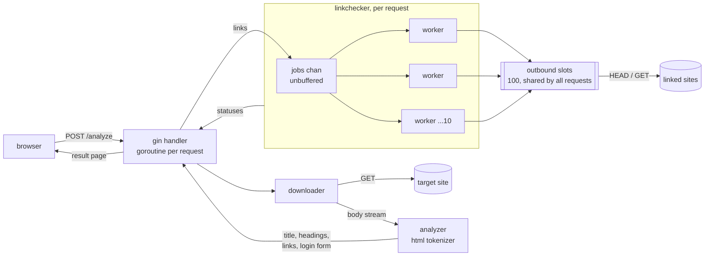

# pagechecker

analyze a web page. shows html version, title, headings, links and whether it has a login form.

build steps, assumptions and possible improvements are in [NOTES.md](NOTES.md).

## how it works



concurrency lives in two places. gin runs every request in its own goroutine,
and the linkchecker runs workers inside each request.

### streaming, the page is never fully in memory

the downloader doesn't read the whole body into a `[]byte`. it hands the
response stream to the analyzer, and the html tokenizer reads it in small
chunks. we only keep what we need: title, heading counts, links and the login
flag. so memory per request stays small even for big pages, and the stream is
capped at `max_body_mb` anyway.

### bounded worker pool for link checking

checking links is the slow part, so it runs in parallel but bounded:

- every request starts its own `workers` and feeds links through an
  unbuffered channel. a link is only handed out when a worker is free
- before calling a link, a worker takes a slot from `outbound`, a buffered
  channel shared by the whole server (100). so no matter how many users, at
  most 100 links are checked at once
- workers stop when the request is done, a `sync.WaitGroup` waits for them
- if the user leaves, the request context is canceled and the rest of the links
  are skipped
- links are checked with HEAD, GET if the site doesn't allow HEAD. every link
  gets a status, inaccessible ones are logged with the status code

## run dev server

install tools first

```sh
go install github.com/air-verse/air@latest
go install github.com/a-h/templ/cmd/templ@latest
```

then run it, it reloads on code changes

```sh
make dev
```

open http://localhost:8000

## run prod server

pprof is on in the default config, so turn it off for prod. make a `prod.ini`
with only the values you want to change

```ini
[server]
pprof = false
```

then mount it and point `PAGECHECKER_CONFIG` to it

```sh
docker build -t pagechecker .
docker run --rm -p 8000:8000 -e GIN_MODE=release \
  -v $(pwd)/prod.ini:/etc/pagechecker.ini:ro \
  -e PAGECHECKER_CONFIG=/etc/pagechecker.ini \
  pagechecker
```

open http://localhost:8000

## config

defaults are in `config/config.ini` and built into the binary. `PAGECHECKER_CONFIG` env
points to another ini file, its values override the defaults. works without
docker too

```sh
PAGECHECKER_CONFIG=./prod.ini go run ./cmd
```

## tests

`make test` runs everything, `make cover` shows coverage (~95% of functions).
unit tests use local `httptest` servers, no real http calls.
`cmd/main_test.go` is the integration test: it runs the real router,
downloader, analyzer and link checker together against a fake local site.

## pprof

when `pprof = true` it's served on the same port

open http://localhost:8000/debug/pprof/ to see the counts

goroutines, with stacks

```
http://localhost:8000/debug/pprof/goroutine?debug=1
```

memory still in use (`gc=1` runs gc first so freed memory is not counted)

```sh
go tool pprof -sample_index=inuse_space "http://localhost:8000/debug/pprof/heap?gc=1"
```

cpu for 30 seconds, submit some pages while it runs

```sh
go tool pprof "http://localhost:8000/debug/pprof/profile?seconds=30"
```

type `top` in the pprof prompt to see the biggest ones. the heap count on the
index page is not memory, it's the number of places that allocated.
